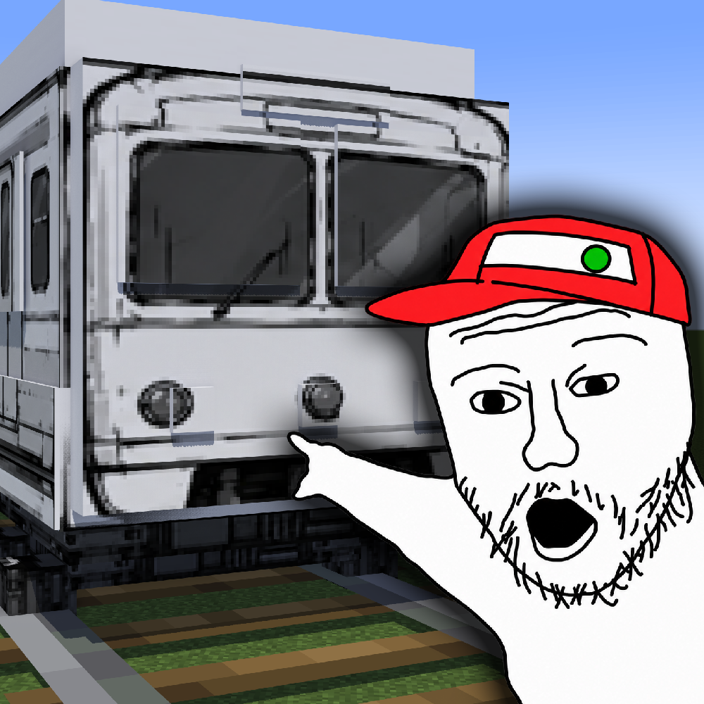

# Trolley-Problem
A Minecraft NeoForge mod featuring trolley dilemmas, drivable trains, chaotic multiplayer PvP, a mysterious railway dimension, and a giant trolley boss.
# Trolley Problem | 电车难题

**Minecraft 1.21.1 · NeoForge · Java 21**

  

> 前方有一辆失控的电车。你有两个选择：拉杆，或者再召唤一辆电车。
>
> There's a runaway trolley ahead. You have two choices: pull the lever, or summon another trolley.

一个以经典哲学思想实验「电车难题」为主题的 Minecraft 模组。

你可以面对各种荒诞的道德选择，亲自驾驶电车，把朋友创飞出去，或是前往神秘的白色终点站，挑战一辆巨大的电车 BOSS。

*A Minecraft mod inspired by the classic Trolley Problem. Make impossible moral choices, drive trolleys, launch your friends into the air, and challenge the ultimate trolley boss.*

## 主要玩法 | Features

- **8 种随机电车难题**：面对各种生死抉择，每次只有 15 秒的决定时间。
- **电车召唤与驾驶**：使用不同拉杆召唤电车，或者亲自拿起方向盘。
- **多人碰碰车 PvP**：驾驶电车互相冲撞，耗尽对手的车辆耐久。
- **白色终点站**：利用电车方块搭建传送门，探索独立的电车次元。
- **至尊电车 BOSS**：挑战巨型电车，获得可以从天上召唤电车的至尊拉杆。
- **生物伦理学家**：一个对电车事故很有意见的特殊村民。

## 游戏操作 | Controls

| 按键 | 功能 |
|---|---|
| W / S | 前进 / 倒车 |
| A / D | 转向 |
| V | 切换普通驾驶与创飞模式 |
| Shift | 下车 |

驾驶电车默认启用创飞模式。按键可以在游戏设置中修改。

## 安装要求 | Requirements

- Minecraft Java Edition 1.21.1
- NeoForge（基于 21.1.244 开发）
- Java 21
- 多人游戏需要客户端和服务器均安装本模组

## 开发与编译 | Building

本项目提供完整 Java 源码与 Gradle 构建配置。

在准备好 Java 21 和相应 Gradle 环境后，可以通过 Gradle 编译项目；Windows 用户也可以使用仓库提供的一键编译脚本。

本项目的 Windows 构建脚本使用预先配置的共享开发环境，具体路径及使用方法见仓库内的构建说明。

## 授权说明 | License

**All Rights Reserved.**

本项目保留所有权利。未经授权，请勿擅自重新发布、分发或将本项目内容用于其他作品。

---

*温馨提示：本模组不提供伦理学标准答案，也不保证任何乘客和受害者的情绪稳定。*

Trolley Problem

Minecraft 1.21.1 | NeoForge | r22.8.1

There is a runaway trolley ahead. You have two choices: pull the lever, or summon another trolley.

Trolley Problem turns the classic philosophical thought experiment into a completely unreasonable Minecraft adventure. Face moral dilemmas, summon dangerously enthusiastic trains, drive your own trolley, challenge your friends to bumper-trolley battles, and explore a mysterious white railway dimension.

Features

Eight Trolley Dilemmas

Encounter randomized scenarios featuring villagers, cats, wolves, creepers, doctors, criminals, children, and even a librarian selling Mending enchanted books.

You have 15 seconds to choose which track the trolley will take. Your decisions determine who survives.

The Mending librarian features a real guaranteed trade: 20 emeralds and 1 book for a Mending I enchanted book.

Summon and Drive Trolleys

Use different trolley levers to unleash high-speed trains, launch enemies into the air, or summon a wild trolley that seeks nearby targets.

Take control of your own trolley with the Steering Wheel. Accelerate, steer, and switch between normal driving and Launch Mode.

Multiplayer Bumper Trolleys

Crash player-driven trolleys into each other in explosive PvP battles. Each vehicle has 40 durability points. Collisions send both vehicles flying apart and gradually wear them down.

The last trolley standing wins. Explosions are visual-only and do not destroy terrain.

The White Terminal

Collect Trolley Blocks from destroyed trains and build a portal to an eerie white dimension featuring railway stations, city structures, passing trains, and mysterious announcements.

The Supreme Trolley Boss

Challenge an enormous trolley with charging attacks, leap slams, spinning attacks, and trolley dilemmas between battle phases.

Defeat it to obtain the legendary Supreme Lever — a plunger capable of summoning a giant trolley from the sky.

A Bioethicist Who Has Opinions

Summon a special villager who comments on the accidents happening around him. Ethical advice is not guaranteed.

Installation

Minecraft Java Edition 1.21.1

NeoForge (developed against 21.1.244)

Java 21

Install on both client and server for multiplayer

Warning: This mod does not provide correct answers to ethical dilemmas, nor does it guarantee the emotional stability of any passengers or victims.

License: All Rights Reserved.
